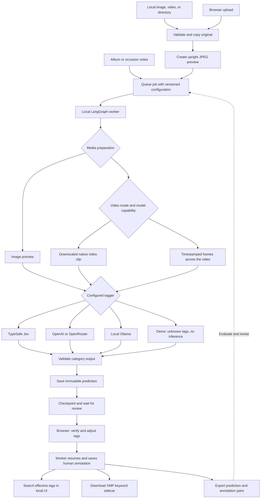

# Photo Metadata Agent

A personal photo and video tagging and review tool for finding the right image later.

Photo libraries know when an image was taken, but often miss the context you remember:
*a candid photo with four to six people from a family gathering*, or *a group shot from
a ministry trip*. This project uses images or video samples plus optional album or occasion notes to
suggest consistent metadata categories. You verify the suggestions, correct mistakes,
and export searchable keywords alongside a record of how each decision was made.

The goal is a small, personal agent whose tagging model can change without rebuilding
the import, review, or evaluation workflow. TypeSafe Jev System One models, OpenAI,
OpenRouter, and locally served Ollama models share the same annotation contract.
Human corrections remain separate from model predictions so they can support prompt
and harness evaluations.

## Workflow



All imported images and videos go through human review. The UI and worker are separate
processes; closing the browser does not discard queued work or pending reviews.

## What it does

- Import local images, videos, or directories through the CLI, or upload media through the UI.
- Route video jobs to native-video or sampled-frame inference with reusable preparation tools.
- Preserve original bytes in managed storage and deduplicate exact files by SHA-256.
- Suggest people-count, capture-style, and independent context labels.
- Run a durable LangGraph inference → review workflow with SQLite checkpoints.
- Review and correct tags in a local browser UI; search filenames and effective keywords
  within the latest 100 runs.
- Export reviewed tags as XMP keywords and prediction/annotation pairs as JSONL.
- Snapshot prompts, questions, provider/model settings, context, and version information.
- Run without credentials using the demo provider, which deliberately returns unknowns.

**Not yet implemented:** direct Google Photos or iCloud album connections, embedded
metadata writes, cloud-library tag synchronization, semantic/vector search, automatic
prompt optimization, or an authenticated hosted deployment.

## Run against a directory

Requires Python 3.11+ and [uv](https://docs.astral.sh/uv/). Run these commands from the
repository root. Installation can provision Python 3.12 if needed:

```bash
cd /path/to/photo-metadata-agent
uv sync --locked --python 3.12
```

Create `.env` from `.env.example` if you do not already have one. This command preserves
an existing `.env`:

```bash
cp -n .env.example .env
```

**Configure a real provider before importing if you want generated tags.** The default
`demo` provider performs no inference and returns unknown tags for manual annotation.
For example, to use an already running local Ollama server and an installed vision model:

```dotenv
PHOTO_AGENT_PROVIDER=ollama
PHOTO_AGENT_MODEL=your-installed-vision-model
PHOTO_AGENT_OLLAMA_URL=http://localhost:11434
```

Replace the model placeholder with the actual installed model ID. For Jev, OpenAI, or
OpenRouter, use the corresponding example in [`configs/providers/`](configs/providers/)
and supply its API key. Set the provider and model together. See [Choose a provider](#choose-a-provider).

**1. Import and queue the directory.** Context is optional, but helps with occasion labels:

```bash
uv run photo-agent import "/absolute/path/to/images" \
  --context "Family reunion, July 2026"
```

The importer scans subdirectories recursively for supported images **and videos**. It
copies originals into managed storage and prints the job IDs it queues; importing alone
does not run inference. Each import creates a new run, including for previously imported
files. Original bytes are deduplicated. An import exits with a nonzero status if any file
fails or no supported files are queued; successfully queued files remain available.

**2. Start the worker** in a terminal from the repository root:

```bash
uv run photo-agent worker
```

The worker processes queued jobs and leaves each ready for human review. It keeps running
and waits for new jobs or submitted reviews. Stop it with Ctrl+C when finished. Use
`worker --once` to process at most one queued import or review resume and then exit;
it does not drain the whole directory.

**3. Start the review UI** in a second terminal from the same repository root:

```bash
uv run photo-agent serve
```

Open [http://127.0.0.1:8000](http://127.0.0.1:8000). Verify or adjust each image/video's
tags, then save. Keep the worker running so it can persist submitted reviews. Afterward,
download XMP keywords from the media page or use `photo-agent export JOB_ID`. Neither
inference nor review automatically modifies metadata in your source directory.

By default, `.env` is read from the current working directory and all state lives in
`./data`. Run the UI, importer, and worker from the same repository directory. For a
custom data directory, place the global `--data-dir` option **before** the subcommand
and use the same absolute path for each process:

```bash
uv run photo-agent --data-dir "/absolute/path/to/catalog" import "/path/to/images"
uv run photo-agent --data-dir "/absolute/path/to/catalog" worker
# In a second terminal:
uv run photo-agent --data-dir "/absolute/path/to/catalog" serve --port 8080
```

For the custom port, open [http://127.0.0.1:8080](http://127.0.0.1:8080). The UI stays
bound to localhost. CLI import options override `.env` for those newly queued jobs;
the worker uses each job's snapshotted provider/model settings. Provider keys are read
when the worker executes the job. Restart the UI after editing `.env` for future uploads.

JPEG, PNG, WebP, and TIFF still images are supported. Add HEIC/HEIF decoding with:

```bash
uv sync --locked --extra heic
```

MP4, MOV, M4V, MKV, WebM, and AVI video files are supported when their codecs are decodable
by PyAV. Animated images remain unsupported. Inference previews have upright pixels,
no EXIF metadata, and dimensions compatible with Jev's documented image limits.
Originals retain their original bytes and metadata.

## Command reference

All commands below follow `uv run photo-agent`. Use `--help` at the root or after any
subcommand to inspect the installed CLI:

```bash
uv run photo-agent --help
uv run photo-agent import --help
uv run photo-agent prepare-video --help
```

| Command | Purpose and options |
| --- | --- |
| `import PATH` | Queue one file or recursively scan a directory. `--context TEXT` supplies occasion notes (maximum 4,000 characters); `--questions PATH` loads a custom question JSON file; `--provider NAME` and `--model ID` override the configured provider/model; `--video-mode auto\|native\|frames` overrides video routing; `--model-supports-video` declares native-video support for the selected model. |
| `worker` | Process queued jobs continuously. `--once` processes at most one queued job or review resume and exits. Only one worker can own a catalog. |
| `serve` | Start the localhost review UI. `--port PORT` defaults to `8000`. |
| `prepare-video PATH --output DIR` | Prepare media without queuing inference. `--mode frames\|native` defaults to `frames`; `--frames N` defaults to `8` (1–32); `--max-side PX` defaults to `768` (280–1568); native options are `--start SECONDS` (default `0`), `--seconds SECONDS` (default `30`, maximum `300`), and `--fps N` (default `4`, 1–30). |
| `export JOB_ID` | Write reviewed XMP keywords under the configured data directory's `exports/` folder and print the path. Requires a saved human review. |
| `evals` | Print descriptive metrics for reviewed runs. `--output PATH` additionally writes prediction/annotation JSONL. |
| `schema` | Generate the canonical tagging JSON Schema. `--output PATH` defaults to `configs/schemas/tags.schema.json`. |

Global option: `--data-dir DIR` overrides `PHOTO_AGENT_DATA_DIR` and must precede the
subcommand. Provider names are `demo`, `typesafe`, `openai`, `openrouter`, and `ollama`.
There is no image-only filter flag: use an image-only input directory when you want to
exclude videos from a recursive import. Standalone `prepare-video` options are its own
CLI defaults; it does not inherit the `PHOTO_AGENT_VIDEO_*` preparation settings.

Additional examples:

```bash
# Queue a single image using the provider configured in .env.
uv run photo-agent import "/path/to/photo.jpg"

# Override provider/model and question instructions for a directory experiment.
uv run photo-agent import "/path/to/images" --provider openrouter \
  --model provider/your-vision-model --questions "/path/to/questions-v2.json"

# Export reviewed keywords and evaluation records.
uv run photo-agent export JOB_ID
uv run photo-agent evals --output data/evals/reviewed.jsonl

# Regenerate a schema at a custom location.
uv run photo-agent schema --output data/schemas/tags.schema.json
```

Settings not exposed as CLI flags are read from `.env` or the process environment.
Process environment variables take precedence over `.env`:

| Setting | Default | Meaning |
| --- | --- | --- |
| `PHOTO_AGENT_DATA_DIR` | `./data` | Shared catalog, checkpoints, originals, previews, and exports. |
| `PHOTO_AGENT_PROVIDER` | `demo` | Provider for newly queued jobs. |
| `PHOTO_AGENT_MODEL` | `demo-v1` | Model ID; set this together with a real provider. |
| `PHOTO_AGENT_OLLAMA_URL` | `http://localhost:11434` | Ollama server base URL. |
| `PHOTO_AGENT_TYPESAFE_IMAGES_ENABLED` | `false` | Explicit opt-in required for Jev image/frame input. |
| `PHOTO_AGENT_TIMEOUT_SECONDS` | `120` | Provider HTTP timeout (greater than 0, at most 600 seconds). |
| `PHOTO_AGENT_MAX_ATTEMPTS` | `2` | Total HTTP attempts, including the first (1–5). |
| `PHOTO_AGENT_MAX_UPLOAD_BYTES` | `26214400` | Per-image import limit: 25 MiB. |
| `PHOTO_AGENT_MAX_VIDEO_UPLOAD_BYTES` | `262144000` | Per-video import limit: 250 MiB. |

Remote credentials are `TYPESAFE_API_KEY`, `OPENAI_API_KEY`, or `OPENROUTER_API_KEY`,
according to the selected provider. Keep them in `.env` or the worker's environment.
See [Tag videos](#tag-videos) for all video mode and preprocessing settings.

## Tag videos

Video import uses the same review, search, XMP export, and evaluation workflow as images.
Install dependencies with `uv sync`; PyAV wheels bundle FFmpeg libraries, so no separate
`ffmpeg` or `ffprobe` command is required. Unsupported codecs or files with no decodable
video stream/known duration fail visibly. Originals are preserved, including their audio.

Choose a mode in the upload form, through `--video-mode` on CLI imports, or with
`PHOTO_AGENT_VIDEO_MODE` in `.env`:

| Mode | What the model receives |
| --- | --- |
| `auto` (default) | Native clip only if the adapter and declared model capability support it; otherwise sampled frames |
| `native` | A silent H.264 MP4 clip, downscaled and resampled to bounded duration/FPS |
| `frames` | A chronological sequence of downscaled JPEGs with timestamps, uniformly sampled across the full video |

Native video is implemented through the OpenRouter adapter. Set
`PHOTO_AGENT_MODEL_SUPPORTS_VIDEO=true` **only for a model that supports both video input
and structured output**. Capabilities are declared per configured model, not guessed from
model names or discovered through network calls. Jev, OpenAI, and Ollama use sampled frames
through their current adapters. Explicit native mode on an unsupported adapter fails before
sending media; a failed native request does not silently trigger a second billed frame request.
Sampled mode requires a vision model that accepts multiple images in a single request.

```bash
# Use any of the existing vision adapters with timestamped frame samples.
uv run photo-agent import /path/to/video.mp4 --video-mode frames

# A compatible OpenRouter model can receive a prepared MP4 directly.
uv run photo-agent import /path/to/video.mp4 --provider openrouter \
  --model your-video-capable-model --model-supports-video --video-mode native
```

Defaults: **8 frames** across the full video, or a native clip from the **first 30 seconds**
at **4 FPS**, with longest side at most **768 pixels**. Native audio is stripped. Frame
images are padded to a 280-pixel minimum dimension for Jev compatibility. Native clip
output is capped at 20 MiB; video imports at 250 MiB (image imports retain their 25 MiB
limit). Configure these limits in `.env`:

```dotenv
PHOTO_AGENT_VIDEO_MODE=auto
PHOTO_AGENT_MODEL_SUPPORTS_VIDEO=false
PHOTO_AGENT_VIDEO_FRAME_COUNT=8
PHOTO_AGENT_VIDEO_MAX_SIDE=768
PHOTO_AGENT_VIDEO_START_SECONDS=0
PHOTO_AGENT_VIDEO_MAX_SECONDS=30
PHOTO_AGENT_VIDEO_FPS=4
PHOTO_AGENT_VIDEO_MAX_BYTES=20971520
PHOTO_AGENT_MAX_VIDEO_UPLOAD_BYTES=262144000
```

Start/duration/FPS settings apply to native mode; frame mode samples the entire timeline.
A preparation node calls deterministic tools in
[`tools/video.py`](src/photo_metadata_agent/tools/video.py): `probe_video`,
`sample_video_frames`, and `downscale_video`. You can run preparation independently:

```bash
uv run photo-agent prepare-video /path/to/video.mp4 --output data/samples/frames \
  --mode frames --frames 8 --max-side 768
uv run photo-agent prepare-video /path/to/video.mp4 --output data/samples/clip \
  --mode native --start 10 --seconds 20 --fps 4 --max-side 768
```

Each tool returns artifact paths and timing/coverage metadata. Jobs keep a preparation
manifest under `data/prepared/JOB_ID/` and include it in predictions/evaluation exports.
Only media bytes and timing/coverage information are sent to providers; local paths are
not included in their requests. The review UI plays the original video (when its codec
is browser-compatible) and explains what sample the model saw.

For videos, **people count means the maximum simultaneously visible in the supplied
footage**, not the number of unique people across time. Capture style can be mixed
across scenes. Sparse frames and trimmed clips can miss events; tags describe the sample
and need human verification against the original. Both modes currently use visual
content only, with no transcription or audio-based tags.

## Choose a provider

Set `PHOTO_AGENT_PROVIDER` and `PHOTO_AGENT_MODEL` together in `.env`, plus the key
for remote providers. Restart the UI after changing settings. Jobs already queued
retain their original configuration; use **Queue a new run with current settings**
to compare another model or retry a failed run.

| Provider | Required configuration | Behavior |
| --- | --- | --- |
| `demo` | `PHOTO_AGENT_MODEL=demo-v1` | No inference or network calls; manual review |
| `typesafe` | `TYPESAFE_API_KEY`, model ID, image opt-in | Jev typed Choice questions |
| `openai` | `OPENAI_API_KEY`, model ID | Chat Completions with image + strict JSON Schema |
| `openrouter` | `OPENROUTER_API_KEY`, full model ID | Same output schema; requires parameter support |
| `ollama` | Installed vision model ID; optional server URL | Native `/api/chat` with image + JSON Schema |

Ready-to-copy examples are in [`configs/providers/`](configs/providers/). Select a model
that actually supports images and structured output; a shared interface cannot add
capabilities to a model that lacks them. Real-provider adapters have mocked contract
tests; live paid inference has not been verified for this initial release.

For Jev 1.14, copy [`configs/providers/typesafe.env.example`](configs/providers/typesafe.env.example)
to `.env` and supply your key. Image support is experimental and requires
`PHOTO_AGENT_TYPESAFE_IMAGES_ENABLED=true`; the adapter sends the required image header.
See [TypeSafe image documentation](https://docs.typesafe.ai/images).

CLI imports can override the provider/model for an experiment:

```bash
uv run photo-agent import /path/to/photos --provider ollama --model your-vision-model
```

For instruction experiments, copy
[`questions.json`](src/photo_metadata_agent/resources/questions.json), edit the descriptions,
and pass `--questions /path/to/questions-v2.json`. Allowed values must still match the
domain schema. See [`configs/questions/README.md`](configs/questions/README.md).

## Categories and metadata

| Field | Values |
| --- | --- |
| People count | `0`, `1`, `2-3`, `4-6`, `7-9`, `10+`, `unknown` |
| Capture style | `candid`, `staged`, `mixed`, `unknown` |
| Contexts | Independent `event`, `ministry_trip`, `family`: yes, no, or unknown |

Family relationships and ministry-trip context need supplied evidence; the instructions
do not ask the model to infer kinship or religious affiliation from appearance. These
remain model suggestions until you review them. A human review confirms the full tag set.

A reviewed image can export keywords such as `people:4-6`, `capture:candid`, and
`context:family` in XMP `dc:subject`. Unknowns and negative contexts do not become keywords.
The app writes its own sidecars under `data/exports/`; it does not modify originals or
existing adjacent sidecars. Download or copy a sidecar beside the corresponding original
and name it according to the receiving photo manager's convention. Import behavior varies;
exporting a sidecar does not update Google Photos or Apple Photos automatically.

```bash
uv run photo-agent export JOB_ID
uv run photo-agent evals --output data/evals/reviewed.jsonl
```

The evaluation command also prints per-field accuracy on known reviewed labels and
prediction abstention rate. This is a descriptive report, not a held-out benchmark.
See [`evals/README.md`](evals/README.md) for the annotation and comparison workflow.

## Repository structure

```text
src/photo_metadata_agent/
  domain/       Canonical annotation contracts
  ingestion/    Image/video validation, normalization, managed copies
  tools/        Video probing, uniform frame sampling, bounded MP4 encoding
  inference/    Tagger interface and provider adapters
  agent/        LangGraph workflow and durable worker
  services/     Import, run specification, evaluation operations
  storage/      SQLite catalog, queue, predictions, reviews
  metadata/     Portable XMP keyword export
  api/          FastAPI routes and application factory
  ui/           Jinja templates, CSS, small status-polling script
  prompts/      Shared model instructions
  resources/    Packaged default category questions
configs/        Provider examples, question experiments, generated schemas
skills/         Reserved agent-procedure documentation
evals/         Evaluation guidance
docs/          Design and implementation decisions
tests/         Workflow, API, provider, and ingestion tests
```

## Development

```bash
uv sync --locked --extra dev
uv run ruff check .
uv run ruff format --check .
uv run pytest
uv run photo-agent schema
uv build
```

The committed `uv.lock` makes local and CI dependency resolution reproducible.
Tests use synthetic images and mocked provider responses; they require no API keys.

Data defaults to `./data`. To use another location, set `PHOTO_AGENT_DATA_DIR` or pass
`--data-dir /absolute/path` **before** the subcommand. The UI and worker must point at
the same data directory. Only one worker may run against a catalog; an exclusive file
lock prevents conflicting recovery attempts. `worker --once` processes at most one job.

## Local now, hosted later

The UI uses FastAPI and server-rendered templates with a small JavaScript status poller.
It binds to loopback, rejects unrecognized hosts and cross-origin mutations, and keeps
provider keys on the server. Local execution still sends the prepared images/video and album
notes to the selected remote provider; use demo or a local Ollama server for local-only
processing. Catalogs, originals, responses, notes, and evaluation exports may contain
personal information and are gitignored under `data/`.

Hosting will require authentication, deployment-specific request protection, persistent
storage, and a reachable model service. A hosted server cannot read a laptop directory
or reach laptop-local Ollama directly; use uploads or a future local import client.
Google Photos and iCloud need dedicated ingestion adapters and should not be treated
as ordinary filesystem directories.

See [architecture](docs/architecture.md), [design decisions](docs/decisions.md), and
[provider references](docs/references.md) for the implementation boundaries and next steps.
