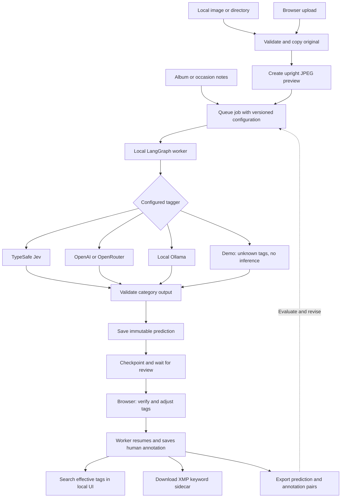

# Photo Metadata Agent

A personal photo tagging and review tool for finding the right image later.

Photo libraries know when an image was taken, but often miss the context you remember:
*a candid photo with four to six people from a family gathering*, or *a group shot from
a ministry trip*. This project uses an image plus optional album or occasion notes to
suggest consistent metadata categories. You verify the suggestions, correct mistakes,
and export searchable keywords alongside a record of how each decision was made.

The goal is a small, personal agent whose tagging model can change without rebuilding
the import, review, or evaluation workflow. TypeSafe Jev System One models, OpenAI,
OpenRouter, and locally served Ollama models share the same annotation contract.
Human corrections remain separate from model predictions so they can support prompt
and harness evaluations.

## Workflow



All imported images go through human review in v1. The UI and worker are separate
processes; closing the browser does not discard queued work or pending reviews.

## What v1 does

- Import a local image/directory through the CLI, or upload one image through the UI.
- Preserve original bytes in managed storage and deduplicate exact files by SHA-256.
- Suggest people-count, capture-style, and independent context labels.
- Run a durable LangGraph inference → review workflow with SQLite checkpoints.
- Review and correct tags in a local browser UI; search filenames and effective keywords
  within the latest 100 runs.
- Export reviewed tags as XMP keywords and prediction/annotation pairs as JSONL.
- Snapshot prompts, questions, provider/model settings, context, and version information.
- Run without credentials using the demo provider, which deliberately returns unknowns.

**Not yet implemented:** direct Google Photos or iCloud album connections, embedded
metadata writes, cloud-library tag synchronization, semantic/vector search, automatic
prompt optimization, or an authenticated hosted deployment.

## Quick start

Requires Python 3.11+ and [uv](https://docs.astral.sh/uv/). Commands below run from the
repository root. `uv sync` can install a suitable Python interpreter if needed.

```bash
uv sync --python 3.12 --extra dev
cp .env.example .env
```

Start the UI in one terminal:

```bash
uv run photo-agent serve
```

Start the worker in another terminal, from the same directory:

```bash
uv run photo-agent worker
```

Open [http://127.0.0.1:8000](http://127.0.0.1:8000). Upload a photo, wait for the worker,
review the categories, and save. In demo mode, no model call occurs; all initial tags
are unknown. After the worker saves your review, download the XMP sidecar from the
photo page.

To import an entire directory:

```bash
uv run photo-agent import /absolute/path/to/photos --context "Family reunion, July 2026"
```

The importer scans supported image extensions recursively. Invalid files are skipped
with a failure count and a nonzero exit status; successfully queued files remain available.
Each import creates a new tagging run, even when the underlying asset already exists.

JPEG, PNG, WebP, and TIFF still images are supported. For HEIC/HEIF:

```bash
uv sync --extra dev --extra heic
```

Animated images and videos are outside v1. Inference previews have upright pixels,
no EXIF metadata, and dimensions compatible with Jev's documented image limits.
Originals retain their original bytes and metadata.

## Choose a provider

Set `PHOTO_AGENT_PROVIDER` and `PHOTO_AGENT_MODEL` together in `.env`, plus the key
for remote providers. Restart the UI after changing settings. Jobs already queued
retain their original configuration; use **Queue a new run with current settings**
to compare another model or retry a failed run.

| Provider | Required configuration | Behavior |
| --- | --- | --- |
| `demo` | `PHOTO_AGENT_MODEL=demo-v1` | No inference or network calls; manual review |
| `typesafe` | `TYPESAFE_API_KEY`, model ID, image opt-in | Jev typed Choice questions |
| `openai` | `OPENAI_API_KEY`, model ID | Chat Completions with image + strict JSON Schema |
| `openrouter` | `OPENROUTER_API_KEY`, full model ID | Same output schema; requires parameter support |
| `ollama` | Installed vision model ID; optional server URL | Native `/api/chat` with image + JSON Schema |

Ready-to-copy examples are in [`configs/providers/`](configs/providers/). Select a model
that actually supports images and structured output; a shared interface cannot add
capabilities to a model that lacks them. Real-provider adapters have mocked contract
tests; live paid inference has not been verified for this initial release.

For Jev 1.14, copy [`configs/providers/typesafe.env.example`](configs/providers/typesafe.env.example)
to `.env` and supply your key. Image support is experimental and requires
`PHOTO_AGENT_TYPESAFE_IMAGES_ENABLED=true`; the adapter sends the required image header.
See [TypeSafe image documentation](https://docs.typesafe.ai/images).

CLI imports can override the provider/model for an experiment:

```bash
uv run photo-agent import /path/to/photos --provider ollama --model your-vision-model
```

For instruction experiments, copy
[`questions.json`](src/photo_metadata_agent/resources/questions.json), edit the descriptions,
and pass `--questions /path/to/questions-v2.json`. Allowed values must still match the
domain schema. See [`configs/questions/README.md`](configs/questions/README.md).

## Categories and metadata

| Field | Values |
| --- | --- |
| People count | `0`, `1`, `2-3`, `4-6`, `7-9`, `10+`, `unknown` |
| Capture style | `candid`, `staged`, `mixed`, `unknown` |
| Contexts | Independent `event`, `ministry_trip`, `family`: yes, no, or unknown |

Family relationships and ministry-trip context need supplied evidence; the instructions
do not ask the model to infer kinship or religious affiliation from appearance. These
remain model suggestions until you review them. A human review confirms the full tag set.

A reviewed image can export keywords such as `people:4-6`, `capture:candid`, and
`context:family` in XMP `dc:subject`. Unknowns and negative contexts do not become keywords.
The app writes its own sidecars under `data/exports/`; it does not modify originals or
existing adjacent sidecars. Download or copy a sidecar beside the corresponding original
and name it according to the receiving photo manager's convention. Import behavior varies;
exporting a sidecar does not update Google Photos or Apple Photos automatically.

```bash
uv run photo-agent export JOB_ID
uv run photo-agent evals --output data/evals/reviewed.jsonl
```

The evaluation command also prints per-field accuracy on known reviewed labels and
prediction abstention rate. This is a descriptive report, not a held-out benchmark.
See [`evals/README.md`](evals/README.md) for the annotation and comparison workflow.

## Repository structure

```text
src/photo_metadata_agent/
  domain/       Canonical annotation contracts
  ingestion/    Image validation, normalization, managed copies
  inference/    Tagger interface and provider adapters
  agent/        LangGraph workflow and durable worker
  services/     Import, run specification, evaluation operations
  storage/      SQLite catalog, queue, predictions, reviews
  metadata/     Portable XMP keyword export
  api/          FastAPI routes and application factory
  ui/           Jinja templates, CSS, small status-polling script
  prompts/      Shared model instructions
  resources/    Packaged default category questions
configs/        Provider examples, question experiments, generated schemas
skills/         Reserved agent-procedure documentation
evals/         Evaluation guidance
docs/          Design and implementation decisions
tests/         Workflow, API, provider, and ingestion tests
```

## Development

```bash
uv sync --locked --extra dev
uv run ruff check .
uv run ruff format --check .
uv run pytest
uv run photo-agent schema
uv build
```

The committed `uv.lock` makes local and CI dependency resolution reproducible.
Tests use synthetic images and mocked provider responses; they require no API keys.

Data defaults to `./data`. To use another location, set `PHOTO_AGENT_DATA_DIR` or pass
`--data-dir /absolute/path` **before** the subcommand. The UI and worker must point at
the same data directory. Only one worker may run against a catalog; an exclusive file
lock prevents conflicting recovery attempts. `worker --once` processes at most one job.

## Local now, hosted later

The UI uses FastAPI and server-rendered templates with a small JavaScript status poller.
It binds to loopback, rejects unrecognized hosts and cross-origin mutations, and keeps
provider keys on the server. Local execution still sends the prepared image and album
notes to the selected remote provider; use demo or a local Ollama server for local-only
processing. Catalogs, originals, responses, notes, and evaluation exports may contain
personal information and are gitignored under `data/`.

Hosting will require authentication, deployment-specific request protection, persistent
storage, and a reachable model service. A hosted server cannot read a laptop directory
or reach laptop-local Ollama directly; use uploads or a future local import client.
Google Photos and iCloud need dedicated ingestion adapters and should not be treated
as ordinary filesystem directories.

See [architecture](docs/architecture.md), [design decisions](docs/decisions.md), and
[provider references](docs/references.md) for the implementation boundaries and next steps.
