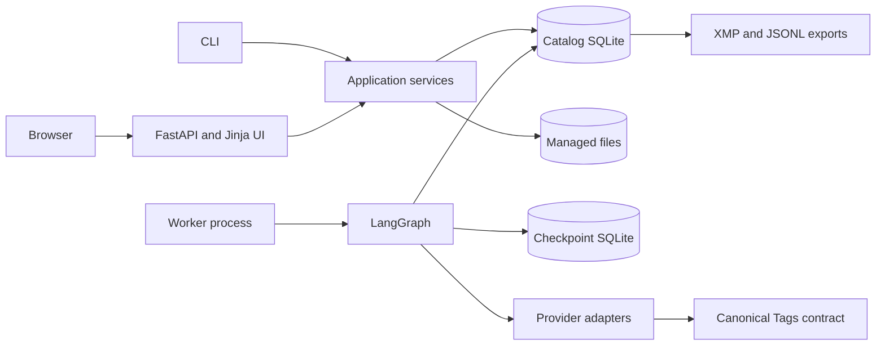
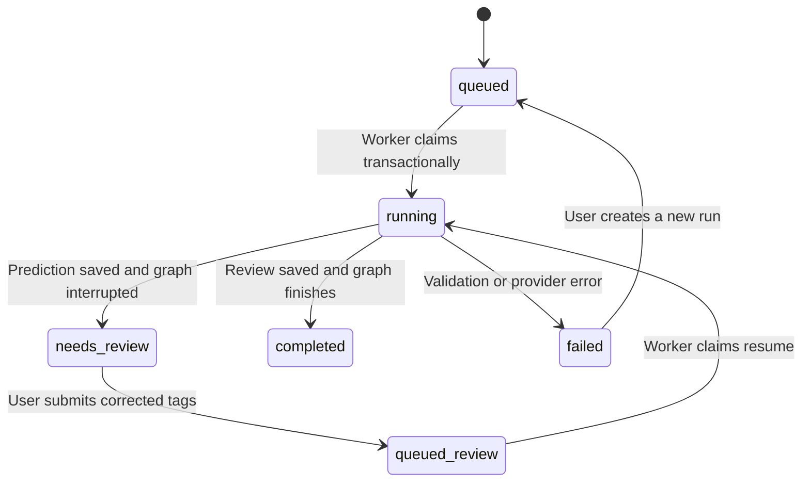

# Architecture

## Intention and v1 scope

Build a personal image library whose categories reflect how its owner searches:
number of people, capture style, and occasion context. Model suggestions are reviewable,
portable as keyword metadata, and traceable to their exact inputs. User corrections
produce evaluation material without replacing the original model result.

The first release covers local directory imports and browser uploads, five normalized
tag fields, configurable model adapters, human review, XMP sidecars, and evaluation export.
Direct cloud-album integration and hosted operation are separate milestones.

## Boundaries

- `domain`: strict Pydantic types independent of UI, graph, or provider SDKs.
- `ingestion`: validate images and create managed originals/previews. It never tags images.
- `inference`: adapt image/context/question requests into one `Prediction` contract.
- `agent`: bounded graph execution, durable interrupts, and worker lifecycle.
- `services`: import orchestration, immutable experiment specifications, and eval reports.
- `storage`: SQLite persistence and transactional queue transitions.
- `metadata`: map positive, known decisions into interoperable keywords.
- `api` and `ui`: transport and presentation; they do not run inference in request handlers.

No open-ended tool loop is needed in v1. Models cannot read directories, write metadata,
or execute skills. A future agent-callable `tools/` package should wrap services rather
than duplicate their implementations. `skills/` remains documentation until procedures
need to be discovered or composed dynamically.

## Data model

| Entity | Identity | Contents |
| --- | --- | --- |
| Asset | SHA-256 of original bytes | Display filename, managed original and preview |
| Source | Asset ID + source reference | Local path or upload provenance |
| Job | UUID | Asset reference, immutable experiment spec, status, prediction |
| Review | UUID | Job reference, complete corrected tags, reviewer, notes, timestamp |
| Graph checkpoint | Job UUID as thread ID | Execution state and interrupt/resume records |

Exact duplicate files share an asset. Each import creates a new run and retains its own
album context, allowing the same file to be evaluated with different evidence. The first
filename is the asset display name; source references retain additional import locations.
Different encodings of the same visual image have different hashes. Near-duplicate
clustering and filesystem change tracking are future work.

The catalog's prediction JSON includes normalized tags, provider-native raw response,
provider scores when available, resolved model, and observed inference latency.
Jev's distributions remain in the raw response. Chat models are not asked to invent
confidence values. Scores across providers are not assumed to be calibrated or comparable.

A human review confirms all five fields and has authority over the effective tag set.
The original prediction remains intact. V1 accepts one completed review per run; changes
can be annotated on a new run. The reviews table supports append-only records, but a
revision/re-adjudication UI is deferred. Field-specific reviewer attribution is also deferred.

## Category semantics

Single-choice fields have `unknown`; context fields use nullable booleans. Null is
insufficient evidence, false is a known negative, and true is a known positive. Context
labels overlap. Family and ministry context require explicit supplied evidence; the prompt
prohibits drawing those conclusions from appearance alone. These instructions are not a
guarantee of correctness, so every result is reviewed.

Pydantic is the canonical output contract. `photo-agent schema` generates the committed
JSON Schema snapshot. The versioned question file supplies instructions and criteria,
not a second independently maintained output schema. The CLI verifies category keys
against the domain contract when custom question files are used.

Jev uses Choice for all fields, including yes/no/unknown contexts. A Noul-only classifier
cannot directly distinguish missing evidence from an explicit negative. Noul experiments
could introduce a separate evidence-availability gate later. All providers produce the
same normalized tags, while preserving their native responses for comparison.

## Image lifecycle

1. Read a supported still image within the configured 25 MiB default limit.
2. Validate/decode before registering the asset.
3. Copy original bytes under `originals/<sha256>`.
4. Rotate pixels using EXIF orientation, convert to RGB, bound the longest side to 1568,
   and pad dimensions under 280 pixels for Jev compatibility.
5. Save a metadata-free JPEG derivative under `previews/<sha256>.jpg`.
6. Atomically replace managed files to avoid partial reads.

V1 normalizes all provider inputs identically to make comparisons easier. Provider-specific
resolution strategies and high-resolution crops are future experiments. Original metadata
is preserved in copied bytes but is not automatically passed to the model. Explicit album
notes are passed to the model and snapshotted with the run.

## Queue and graph execution

A single worker owns an exclusive file lock for the catalog. SQLite transactions claim
one queued job at a time. Interrupted jobs do not block processing other jobs. The UI
stores the resume payload transactionally; it does not need the worker to be running at
submission time. Each worker process opens persistent LangGraph SQLite checkpoints.

On startup, the worker recovers jobs left `running` after a crash. It inspects the graph
checkpoint to resume from the last persisted step, or recognize completed execution.
A persisted prediction is reused rather than issuing another paid inference request.
Review writes are idempotent by review UUID. Pending review payloads are retained until
the completion status commits, allowing recovery if the process stops during resume.

There is no exactly-once guarantee for external model calls: a crash after a provider
responds but before the prediction is persisted can cause another call. HTTP retries
are limited to network failures, rate limits, and server errors, with short bounded
backoff. Authentication errors, refusals, truncated responses, and invalid category
outputs fail the run visibly. There is no silent provider fallback.

The checkpoints are operational state; the catalog is authoritative for user-facing
annotations and exported results. They have separate database files and no cross-file
transaction. Recovery handles the principal status/checkpoint ordering gaps; backing up
the whole data directory while processes are stopped is the simplest consistent backup.

## Review interface

The first UI is a single Python web application using Jinja templates, CSS, and a small
status-polling script. HTMX was unnecessary for the initial full-form interactions;
its introduction later would not change the API/service boundary. No frontend bundler
or external CDN is needed.

The library shows the latest 100 runs and filters their filenames/keywords and statuses.
The detail page shows the photo, supplied context, original prediction, editable categories,
and notes. Saving submits a full annotation. Export becomes available after worker resume.
A new run can use current provider/model settings while preserving previous results.

This release does not claim scalable library search or a polished bulk-annotation workflow.
Pagination, keyboard navigation, per-field review, and bulk approvals can follow.

## Evaluation

JSONL exports join each reviewed run's immutable prediction and configuration with its
latest annotation. Keys include asset hash and album-context group information. The
built-in report counts known-label accuracy per field and prediction abstention rate;
unknown human labels are excluded from accuracy denominators.

It is descriptive, includes demo runs, and reflects the reviewed sample. Prompt tuning,
model comparison, latency/cost analysis, F1, and held-out evaluation are follow-up work.
Freeze independent labels and group album events/near-duplicates before making claims
about improvement. The raw provider usage payload can support future cost accounting;
v1 does not hardcode prices or compute costs.

## Local deployment and future hosting

Local state is stored under a configurable directory; UI and worker must share it. The
web server binds to loopback and allows localhost hostnames. The UI serves previews by
registered job ID rather than accepting arbitrary server file paths. Jinja autoescapes
text, mutations reject cross-origin browser requests, and response headers restrict
scripts, framing, and external resources. API keys are read at execution time and never
included in job specifications or exports. Raw SDK errors are not shown or logged.

There is no authentication in this release, so it must remain local. Hosted deployment
needs authentication, explicit origin configuration and CSRF protection, upload/body
limits at the proxy, persistent storage, and backup/retention decisions. SQLite and one
worker are adequate starting points; multiple workers require a stronger queue/claim
lease design and usually a shared database. Storage and repository boundaries provide
places for those changes without modifying the tagging contract.

Remote providers receive prepared images and album notes. A hosted server cannot access
a user's local directory or laptop-local Ollama automatically. Browser uploads work with
the same import operation; a future authenticated local importer could bridge local files
and models without granting the server arbitrary filesystem access.

## Cloud source roadmap

- Google Photos: user-selected import via Picker or exported directories. Library API
  access to arbitrary existing user albums is not a valid assumption after its 2025 changes.
- iCloud/Apple Photos: exported originals and optional XMP are the initial supported route.
  Direct album access requires a dedicated adapter and platform investigation.
- Metadata writeback: file keywords are an export feature. Cloud library mutation and search
  indexing are separate capabilities, not implied by downloading or tagging an image.

Neither cloud adapter is implemented in v1; avoid empty connector stubs that imply support.
